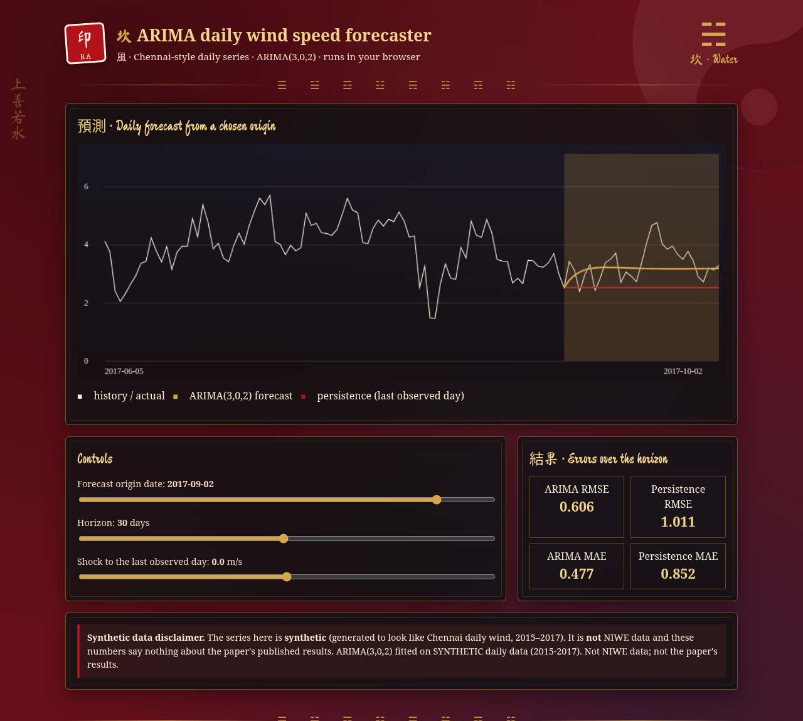

# ARIMA and SARIMA Wind Speed Forecasting for Chennai, India (Python, statsmodels)

[](https://rishabh-bgp.github.io/arima-sarima-wind-speed-chennai/) [](https://github.com/Rishabh-bgp/arima-sarima-wind-speed-chennai/actions/workflows/ci.yml) [](https://colab.research.google.com/github/Rishabh-bgp/arima-sarima-wind-speed-chennai/blob/main/notebooks/walkthrough.ipynb) [](LICENSE) 

Daily wind speed time-series forecasting for Chennai (NIWE Pallikaranai, 2015-2017 setup) with ARIMA(3,0,2) and SARIMA(0,1,2)(0,1,2,4), ADF stationarity test, ACF/PACF and AIC order selection, MSE/RMSE evaluation, plus a public NASA POWER data fetcher. Renewable energy / wind energy statistics, M.Tech thesis work, IIIT Bhagalpur.

[](https://rishabh-bgp.github.io/arima-sarima-wind-speed-chennai/)

**Live demo:** https://rishabh-bgp.github.io/arima-sarima-wind-speed-chennai/ (runs entirely in your browser on synthetic data)

**About the demo design.** The page uses a Daoist, Chinese-ink style: crimson, charcoal and navy with gold accents, brush-style headings in the Ma Shan Zheng font, and charts drawn in gold, red and ink. Each repository has its own trigram. This one is **坎 ☵ (Kǎn, Water)**. 坎 (Kǎn) is water: flowing and returning to its level. It fits coastal Chennai and ARIMA's mean-reverting forecasts. The red seal stamp (印) carries the initials RA, the faint taiji and the row of eight Bagua trigrams stand for balance and change, the cloud scrolls stand for moving air, and the vertical motto 上善若水 means "The highest good is like water". The design is purely decorative. Everything is computed by the model shown, on synthetic data.

## 論文 · What the paper proposes

The paper models **daily wind speed in Chennai** (NIWE met mast, Pallikaranai, 2015–2017) with classical time-series models. It checks stationarity with the ADF test, identifies orders from ACF/PACF and AIC, and compares **ARIMA(3,0,2)** with **SARIMA(0,1,2)(0,1,2,4)** using MSE and RMSE on two test sets, concluding that ARIMA is more accurate.

## What this repository implements

- Daily mean wind speed series (the paper: NIWE met mast, 45 m, Pallikaranai, Chennai, 2015–2017).
- **Augmented Dickey-Fuller** stationarity test (autolag = AIC), **ACF / PACF** values for order identification, and an optional **AIC grid search** for the ARIMA order.
- **ARIMA(3, 0, 2)** and **SARIMA(0, 1, 2)(0, 1, 2, 4)** exactly as reported, fitted with `statsmodels` (`ARIMA`, `SARIMAX`) and forecast statically over the test period, as in the paper's code listing.
- **Two tests**, mirroring the paper's "Test 1 / Test 2": `test1_last30days` (last 30 days held out, as in the code listing) and `test2_80_20` (80:20 split described in the text, done chronologically here).
- Metrics: **MSE and RMSE** (the paper's metrics) plus MAE, MAPE and R2.

## 架構 · Architecture

```
daily series -> ADF test -> ACF/PACF + AIC -> ARIMA(3,0,2) | SARIMA(0,1,2)(0,1,2,4) -> static forecast over the test window -> MSE / RMSE
```

## Quick start

```bash
python -m venv .venv && source .venv/bin/activate   # Windows: .venv\Scripts\activate
pip install -r requirements.txt
python train.py --quick      # fast check (skips the AIC search)
python train.py              # both tests + AIC order search
python -m pytest -q          # tests (incl. JS-vs-Python demo check; needs Node.js)
```

Outputs: `results/metrics.csv`, `results/predictions.csv`, `results/details.json` (ADF, ACF/PACF, AIC-best order).

## Notebook

[](https://colab.research.google.com/github/Rishabh-bgp/arima-sarima-wind-speed-chennai/blob/main/notebooks/walkthrough.ipynb)

[`notebooks/walkthrough.ipynb`](notebooks/walkthrough.ipynb) is a beginner-friendly, self-contained version of the code, with explanations in plain words. It runs in Colab or in Anaconda Jupyter on Windows, macOS or Linux:

1. Load the synthetic daily CSV (local file, else download from GitHub, else generate it).
2. Plot the series.
3. Run the ADF stationarity test.
4. Hold out the last 30 days.
5. Fit ARIMA(3,0,2) and SARIMA(0,1,2)(0,1,2,4).
6. Compare MSE, RMSE, MAE, MAPE and R² with a persistence baseline.
7. Plot the forecasts.

## 數據 · Data

**The original NIWE dataset used in the paper is not publicly available** and is not, and will never be, included here.

- `data/synthetic/synthetic_chennai_daily.csv` is a **SYNTHETIC** daily wind speed series (2015–2017) generated by `scripts/make_synthetic_data.py` (seed 42). It is committed only so the code runs out of the box. It is not measured data.
- `python scripts/fetch_nasa_power.py` downloads a **public** Chennai-like alternative: NASA POWER daily 10 m wind speed (WS10M) at 12.94 N, 80.21 E for 2015–2017 (reanalysis, not the 45 m NIWE mast). It is saved to `data/nasa_power_chennai_daily.csv`.
- To use your own data, put a CSV with columns `date,wind_speed` under `data/` and point `data.csv` in `configs/default.yaml` at it. Everything in `data/` except the committed synthetic CSV is git-ignored.

## 結果 · Results (honest, synthetic data)

These are the real numbers from `python train.py --quick` on the **synthetic** daily CSV. They are **not** the paper's results.

| Test | Model | MSE | RMSE | MAE | MAPE (%) | R² |
|---|---|---:|---:|---:|---:|---:|
| test1_last30days | ARIMA(3, 0, 2) | 0.5228 | 0.7231 | 0.5959 | 18.25 | 0.018 |
| test1_last30days | SARIMA(0, 1, 2)(0, 1, 2, 4) | 0.7176 | 0.8471 | 0.6873 | 23.06 | -0.348 |
| test2_80_20 | ARIMA(3, 0, 2) | 0.9952 | 0.9976 | 0.7885 | 21.38 | -0.448 |
| test2_80_20 | SARIMA(0, 1, 2)(0, 1, 2, 4) | 1.4935 | 1.2221 | 1.0012 | 26.08 | -1.173 |

On this synthetic series ARIMA(3,0,2) beats SARIMA in both tests, as in the paper, but both have R² near or below zero. That means a multi-day static forecast is barely better than predicting the mean. The live demo also shows a **persistence** baseline (every future day = the last observed day). For example, from 2 Sep 2017 over 30 days: ARIMA RMSE 0.606 vs persistence 1.011. The notebook prints persistence for the last-30-days test.

## Reference implementation note

> **Reference implementation.** This repository is a reference implementation of my own paper (cited below), rebuilt in Python and run on synthetic data because the original NIWE met-mast data cannot be redistributed. Results from this code will differ from the numbers published in the paper, and this repository does not claim to reproduce them.

### Assumptions and deviations from the paper

- The paper's text says the 80:20 split was done "randomly"; for time series this would leak future data, so it is done **chronologically** here.
- The paper's listing uses the last 30 days as the test set; it is not stated which of "Test 1 / Test 2" this was, so both splits are provided.
- The paper does not state the two test datasets precisely, nor the 45 m vs 10 m height; NASA POWER is only a stand-in.
- Synthetic generator constants (monsoon peaks, noise) are assumptions.

## Citation

R. Aryan and Manimozhi I, "Modeling and forecasting of wind speed using ARIMA and SARIMA models: An empirical study of Chennai city," *Int. J. Res. Adv. Comput. Sci. Eng. (IJRACSE)*, vol. 12, no. 1, pp. 23–45, May 2026. [Online]. Available: https://gnpublication.org/index.php/cse

## License

MIT License, © 2026 Rishabh Aryan. See [`LICENSE`](LICENSE).

## M.Tech Thesis Work in AI and Data Science, IIIT Bhagalpur

This repository is part of my M.Tech thesis work, *An Investigation into Advanced Techniques for Wind Speed Forecasting with Applications to Renewable Energy Grid Integration*.

<!--THESIS_REPO_LIST-->

## Other repositories by Rishabh Aryan

<!--OTHER_REPOS-->
